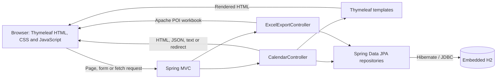
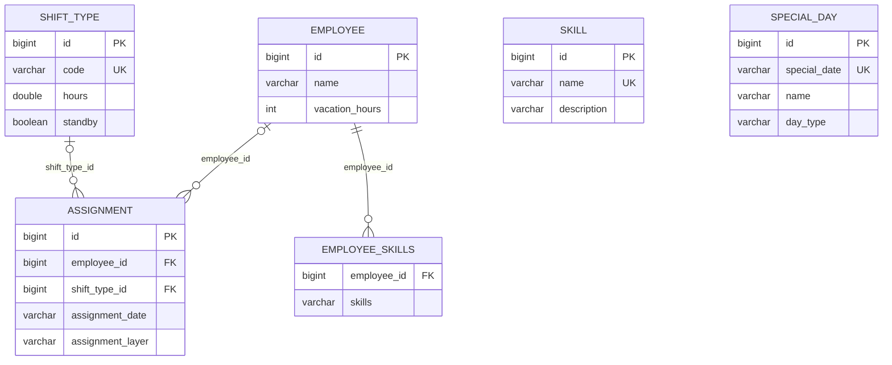
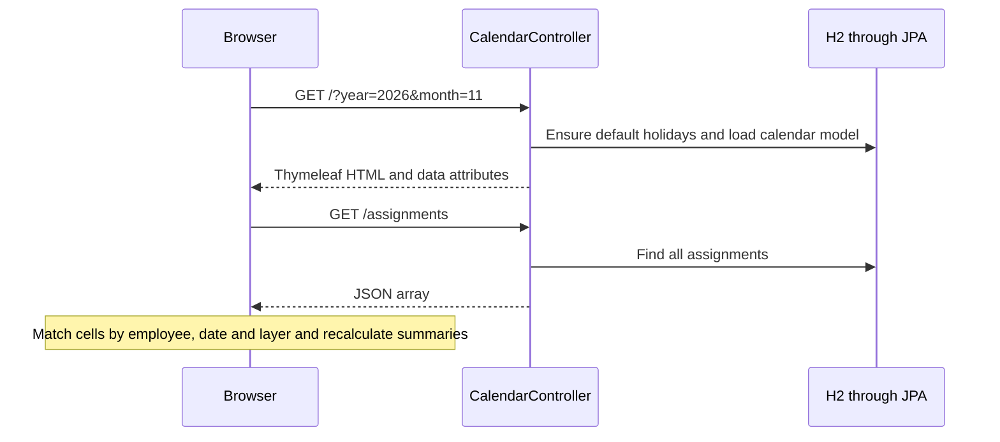
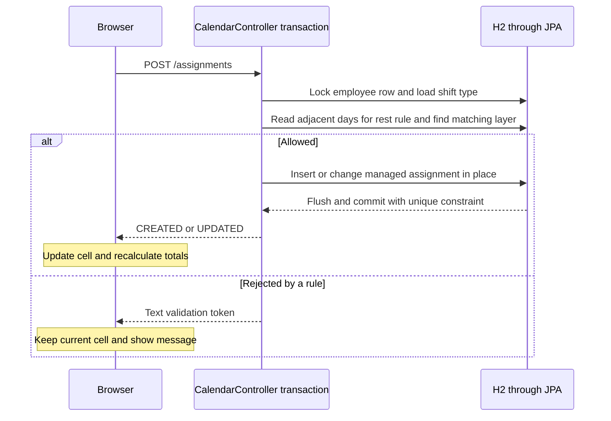

# Scheduler architecture

Scheduler is a single Spring Boot web application. Spring MVC handles HTML, form submissions, JSON and the Excel download. Thymeleaf renders page structure and the available shifts. Browser JavaScript fills assignment cells, performs asynchronous edits and recalculates calendar summaries.



## Repository structure

```text
.
├── pom.xml, mvnw, mvnw.cmd, .mvn/wrapper/
├── src/main/java/com/pufi/scheduler/
├── src/main/resources/
│   ├── application.properties
│   ├── assignment-constraints.sql
│   ├── templates/                 calendar.html, manage.html
│   └── static/                    CSS, calendar.js, theme.js
├── src/test/java/com/pufi/scheduler/
├── e2e/                           Playwright config, fixtures, page objects and specs
├── data/                          Local runtime files, ignored
└── target/                        Build output and test reports, ignored
```

## Backend components

| Component | Responsibility |
| --- | --- |
| [SchedulerApplication](src/main/java/com/pufi/scheduler/SchedulerApplication.java) | Spring Boot entry point and component discovery. |
| [CalendarController](src/main/java/com/pufi/scheduler/CalendarController.java) | Calendar and management models, startup seed records, form validation, assignment operations and rest rules, special-day toggles and default holiday persistence. It calls repositories directly. |
| [ExcelExportController](src/main/java/com/pufi/scheduler/ExcelExportController.java) | Reads four repositories and builds an OOXML attachment in memory with Apache POI. |
| [H2ConsoleConfig](src/main/java/com/pufi/scheduler/H2ConsoleConfig.java) | Registers the H2 Jakarta servlet at `/h2-console/*`. |
| `EmployeeRepository` | Employee CRUD, case-insensitive name checks and employee-level pessimistic lock for assignment writes. |
| `AssignmentRepository` | Assignment CRUD, lookup by employee/date/layer and lookup of all assignments for one employee. |
| `ShiftTypeRepository`, `SkillRepository` | Catalog CRUD and code/name lookups. |
| `SpecialDayRepository` | Special-day CRUD and single-date or date-set lookup. |
| `AssignmentRequest`, `SpecialDayRequest` | JSON request binding classes. |
| `ScheduleDay`, `HolidayDefaults` | Calendar day view data and default holiday calculation. `CalendarDay` is a separate class and is not used by the current calendar route. |

## Frontend

- [calendar.html](src/main/resources/templates/calendar.html) renders navigation, day headers, paired employee rows, shift picker options and summary columns. Assignment cells carry employee ID, date, layer and selected-month metadata.
- [calendar.js](src/main/resources/static/calendar.js) loads assignments, associates each with a cell, sends writes and deletes, recomputes summaries and manages highlighting, holiday toggles, month selection and column preferences.
- [manage.html](src/main/resources/templates/manage.html) renders employee, skill and shift-type forms and the Excel download link. Forms submit normally and receive flash feedback after redirect.
- [base.css](src/main/resources/static/base.css) provides shared values and theme styles, while `calendar.css` and `manage.css` own page-specific layout. [theme.js](src/main/resources/static/theme.js) and early template scripts apply the theme using browser local storage. Column preferences are also local to the browser.

## Database schema

This describes the schema produced by the entity mappings and startup SQL, cross-checked against the DDL emitted by the isolated H2 test run. All five entity tables have a generated `BIGINT` identity primary key named `id`. Text columns shown below are `VARCHAR(255)` by default.

| Table | Remaining columns and constraints |
| --- | --- |
| `employee` | `name` and required integer `vacation_hours`. Name uniqueness is checked by the controller and repository. |
| `employee_skills` | Required `employee_id` FK to `employee` and `skills` text. The element collection stores skill names without a foreign key to the catalog or a separate row ID. |
| `skill` | Unique `name` and `description`. |
| `shift_type` | Unique `code`, `description`, required double-precision `hours` and required boolean `night`, `standby` and `home_office`. |
| `assignment` | Nullable `employee_id` and `shift_type_id` FKs, plus `assignment_date` and `assignment_layer` text. Startup SQL adds `uk_assignment_employee_date_layer` using `UNIQUE NULLS NOT DISTINCT` on employee, date and layer. |
| `special_day` | Unique `special_date`, plus `name` and `day_type`. Dates are independent of assignments. |

Normal writes supply valid employee and shift references and canonical layer values. The unique constraint detects duplicate tuples, including identical tuples with nulls, while the schema still permits nullable assignment fields and does not constrain the layer to a fixed set. [Assignment SQL](src/main/resources/assignment-constraints.sql)



## HTTP endpoints

| Method and path | Input | Output |
| --- | --- | --- |
| `GET /` | Optional integer `year` and `month` | Calendar HTML. Opening the calendar can insert missing default holidays. |
| `GET /manage` | Optional integer `year` and `month` | Management HTML with current catalog records. |
| `GET /assignments` | None | JSON array of all assignments, projected through entity getters. |
| `POST /assignments` | JSON `employeeId`, `date`, `shiftTypeId`, optional `assignmentLayer` | Text token such as `CREATED`, `UPDATED` or a validation result. |
| `DELETE /assignments` | Query `employeeId`, `date`, optional `assignmentLayer` | Text `OK`, `NOT_FOUND` or `EMPLOYEE_NOT_FOUND`. |
| `POST /special-days/toggle-holiday` | JSON `date` | Text `OK` after persistence. |
| `POST /employees`, `/employees/update` | Form `name`, `vacationHours`, optional repeated `selectedSkills`, plus `id` for update | Management redirect with flash feedback. |
| `POST /employees/delete` | Form `id` | Management redirect with flash feedback. |
| `POST /shift-types`, `/shift-types/update` | Form `code`, `hours`, optional `description` and checkbox parameters `night`, `standby` and `homeOffice`, plus `id` for update | Management redirect with flash feedback. |
| `POST /shift-types/delete` | Form `id` | Management redirect with flash feedback. |
| `POST /skills` | Form `skillName` and optional `skillDescription` | Management redirect with flash feedback. |
| `POST /skills/description` | Form `id` and `skillDescription` | Management redirect with flash feedback. |
| `POST /skills/delete` | Form `skillName` | Management redirect with flash feedback. |
| `GET /export/excel` | None | XLSX attachment named `scheduler-export.xlsx`. |
| `/h2-console/*` | H2 console servlet routes | Development database console. |

All management POST forms include integer `year` and `month` for the redirect. The assignment list exposes `id`, `employeeId`, `employeeName`, `date`, `assignmentLayer`, `shiftTypeId`, `shiftCode`, `hours`, `night`, `standby`, `homeOffice`, `shiftDescription` and `shiftDisplayText`. A representative save body is `{"employeeId":1,"date":"2026-11-30","shiftTypeId":2,"assignmentLayer":"NORMAL"}` using illustrative IDs.

## Request and response flows

### Calendar read



### Assignment write



## Transactions and concurrency

Assignment POST and DELETE have controller-level `@Transactional` boundaries. The employee lookup for both requests uses `PESSIMISTIC_WRITE`, so assignment writes for the same employee serialize around neighbor checks and mutation. Distinct employees do not share this row lock. JPA flushes changes to an existing managed row at transaction completion. The database constraint also guards against duplicate tuples from other write paths.

The lock applies to these two assignment endpoints. Catalog edits, employee deletion, holiday toggles and Excel reads do not participate in the same coordination. Employee deletion and skill removal span multiple repository operations without a surrounding controller transaction. Export reads the repositories separately and has no guaranteed cross-sheet snapshot.

## Validation and error handling

- Spring MVC binds JSON or form/query parameters. Required form fields and incompatible input types can fail during binding.
- Controller assignment checks on a successfully bound request return HTTP 200 with plain-text business tokens. `POST /assignments` can return `EMPLOYEE_NOT_FOUND`, `SHIFT_TYPE_NOT_FOUND`, `STANDBY_ONLY_ALLOWED_IN_STANDBY_ROW`, `NORMAL_ONLY_ALLOWED_IN_NORMAL_ROW`, `PREVIOUS_DAY_24H_REST_REQUIRED` or `NEXT_DAY_MUST_BE_EMPTY_AFTER_24H`.
- Date parsing, invalid numeric month ranges or persistence failures can escape controller business handling. The repository has no application-wide error adapter for these cases. Assignment DELETE compares the provided date as text.
- Management handlers report explicit validation failures in Hungarian flash messages. The calendar recognizes known tokens and reports many transport or decoding failures only in the browser console. [Business rules](BUSINESS_RULES.md)

## Configuration and security

[Application properties](src/main/resources/application.properties) configure file-backed H2, `sa` with an empty password, SQL logging and Hibernate `ddl-auto=update`. SQL initialization runs after Hibernate, always includes the assignment constraint script and fails on SQL errors. Tests override the datasource and schema mode. The [README](README.md#database) explains the working-directory dependency.

The project has no application-level authentication, authorization or configured CSRF protection. The console servlet is explicitly registered, so changing only the Spring Boot console setting should not be assumed to remove it. The assignment list and workbook contain employee-related data. Assess access controls and deployment configuration before any shared deployment.

## Architectural limitations

- Controller methods combine request handling, domain checks and persistence orchestration.
- Historical assignments reference mutable catalog records. Employee names, shift flags and hours are resolved when read.
- The calendar loads all assignment rows, even though it renders only the selected month and preceding context days.
- Schema startup combines Hibernate updates and one idempotent SQL script. There is no versioned migration history.
- Business dates and layers are stored as strings. Validation and data constraints cover different parts of the invariant.
- The browser contains two left-column preference implementations and two local storage keys. The workbook is built in memory.

See [QA coverage and the isolated Playwright server](TESTING.md#playwright-e2e) and the [technical backlog](TODO.md).
